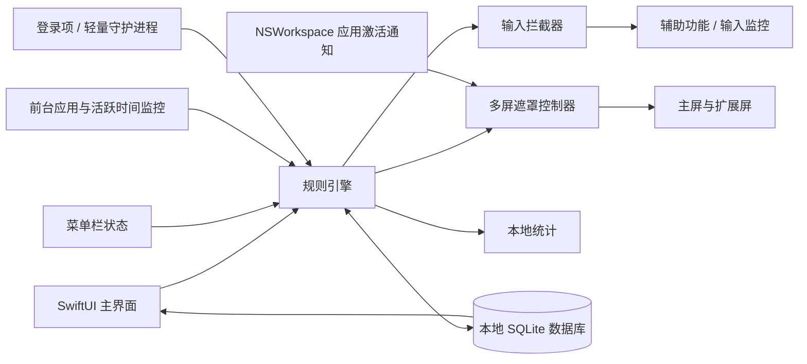

# 守屏：Mac 使用时间与专注管理应用

> 调研日期：2026-11-20  
> 状态：产品与技术计划  
> “守屏”仅为暂定工作名，避免直接沿用“不做手机控”的品牌。

## 1. 结论先行

这个产品值得做，但不能把它理解成“给所有窗口盖一张图”。用户真正需要的是一套可解释、可恢复、逐步加强的干预系统：

1. 到时间后自动进入限制。
2. 限制开始时，所有屏幕都被清楚遮挡。
3. 被禁应用无法获得正常的前台操作体验。
4. 强制档位还能暂时吞掉键盘、鼠标和触控板事件。
5. 到点、达到额度或离开专注时段后，界面立即恢复正常。
6. 程序崩溃、权限被撤销或睡眠唤醒时，不能把电脑弄到无法恢复。

最关键的 macOS 结论是：第三方 Mac 应用不能直接把 iPhone 的 Screen Time Shield API 拿来封禁 Mac 应用。苹果公开的 Family Controls 授权接口面向 iPhone 和 iPad；Managed Settings 的系统盾牌接口也没有可用于原生 macOS 的公开授权路径。应用需要自行监听前台应用，并用 AppKit 覆盖窗口实现界面，输入锁定则要另外使用 Core Graphics 事件拦截。

因此建议分两层：

- **标准模式：** 全屏遮罩、应用检测、时间规则、后台守护。无需拦截输入，风险和实现成本较低。
- **强制模式：** 在标准模式上增加辅助功能与输入监控权限，短时拦截键鼠事件，并启用后台恢复。只对用户主动承诺的场景开放。

首发建议做 **Mac 直装版**，定位“本人自控”，用 Developer ID 签名并公证。App Store 轻量版可以以后再做；家长或学校的强管控若要求不可绕过，应采用 MDM 或受管设备，不能向普通消费者承诺“绝对锁死”。

## 2. 竞品调研

### 2.1 “不做手机控”

安卓版的应用宝介绍列出三类主流程：

- 番茄：快速锁机与预约番茄。
- 监督：限制连续玩机、限制累计玩机、对单个应用设置规则。
- 睡眠：到时间开始睡前锁机。

其宣传还明确提到“强力屏保排除其他 App 干扰”、屏蔽联网、屏蔽页面、双开应用监督，以及按应用定制规则。

iPhone 版的最新公开描述进一步增加了睡眠、专注、循环间歇、学习后解锁、隐私模式、防氪金、冷却时间、成就记录和小队功能。它说明这个品类已经不只是在做计时器，而是在做“规则、摩擦、反馈、同伴关系”的组合。

外部说明不能证明它的内部实现细节。对 Android 而言，常见组合通常是悬浮窗、无障碍服务、使用情况访问、设备管理等系统能力；但对 Mac，我们需要重新验证，不能照搬。

### 2.2 其他相关产品

| 产品 | 主要能力 | 对我们的启示 |
|---|---|---|
| Apple 屏幕使用时间 | 停机时间、应用限额、始终允许、家人共享 | 系统能力最强且无额外权限，但拦截力度留给用户较多主动绕过的空间 |
| Opal Mac | Sessions、Schedules、Open Limits、Time Limits，可屏蔽应用和网站 | 规则模型成熟，也说明 Mac 是独立产品市场 |
| Focus Bear | 应用与网站屏蔽、允许列表、专注会话、日常流程、温和/强力模式 | “先提醒，后强制”的两级干预更符合长期使用 |
| one sec | 打开易分心应用时增加短暂停顿，强调有意识选择 | 小摩擦比重惩罚更容易被长期接受 |
| SelfControl | 对网站设置定时封锁，重启或删除应用也不会提前结束 | “承诺期”本身可以成为卖点，但其范围主要是网络域名 |
| UU 远程防窥模式 | 在 Windows/Mac 被控端覆盖隐私屏；另有客户端安全锁和结束远控自动锁屏 | 证明了 Mac 上全屏遮挡体验可行，也提醒我们“遮屏”和“禁止本地操作”必须分开设计 |

### 2.3 市场空位

针对 Mac 的产品可以从四个差异点切入：

- 真正覆盖多显示器、全屏应用、不同 Space 和唤醒后的桌面。
- 用“只允许这些应用”实现整台电脑进入专注态，而不只是网页黑名单。
- 明确提供“提醒、遮挡、强制”三档强度，避免所有用户都被高强度方案吓退。
- 将统计限制在前台应用和使用时长，不上传窗口标题、网页正文或屏幕内容。

## 3. 目标用户与产品边界

### 3.1 首发用户

第一版服务三类本人自控场景：

- 学生：考前学习、晚间睡眠、结束学习后才开放娱乐应用。
- 知识工作者：上班时间屏蔽短视频或游戏，番茄结束后短暂休息。
- 远程办公者：在强制专注期间让电脑进入只剩白名单的“工作舱”。

### 3.2 暂不作为首发承诺

- 家长远程监控孩子 Mac。
- 企业不可绕过的固定资产管制。
- 对所有浏览器内部网址进行无感识别。
- 击败管理员、恢复模式或物理重启的“防破解”承诺。

这些需求可以做，但分别需要家人共享、MDM、浏览器扩展或网络扩展，属于后续产品线。

## 4. Mac 可行性判断

| 能力 | 可行性 | 推荐实现 | 主要限制 |
|---|---|---|---|
| 全屏、无边框、置顶遮挡 | 高 | 每块屏幕一个 AppKit 覆盖窗口，使用屏幕保护级窗口层级 | 系统登录界面、强制退出等系统 UI 不受普通应用支配 |
| 多显示器与不同 Space | 中高 | 监听屏幕变化、Space 切换与唤醒，重建或重新排序窗口 | 必须在真机上做全矩阵验证 |
| 识别当前前台应用 | 高 | NSWorkspace 应用激活通知，辅以短间隔兜底检查 | 需要建立系统应用和执行程序的开关例外 |
| 启动被禁应用后立即遮挡 | 中高 | 激活通知触发覆盖，隐藏或退回被禁应用 | 极短时间片内可能先露出一帧 |
| 吞掉本地键鼠事件 | 中高 | Core Graphics 事件 tap，在限制期间启用；结束后立即销毁 | 需要辅助功能/输入监控许可，系统安全输入和紧急路径有边界 |
| 按时间自动启动 | 高 | 常驻菜单栏进程、规则引擎、SMAppService 登录项 | 冷启动后要在生成登录会话时恢复 |
| 关闭窗口或误退出后继续运行 | 中高 | 菜单栏常驻，独立轻量守护进程负责拉起主进程 | 不能也不应对抗强制退出、管理员操作和系统恢复 |
| 记录应用使用时长 | 高 | 前台应用激活窗口加间隔采样，按用户活跃时间累计 | 无法获得窗口标题级信息；默认不采集屏幕内容 |
| 直接调用系统 Screen Time 盾牌 | 低 | 不应作为产品基础 | 公开授权和 ManagedSettingsStore 盾牌路径不适用于原生 Mac 第三方应用 |
| 网站级白名单 | 中 | Safari/Chrome/Edge 浏览器扩展，或 Network Extension | 需要分别适配浏览器；网络扩展需要额外 entitlement 与审核 |
| 家长或学校的不可绕过 | 低至中 | MDM、受管设备、策略配置 | 与普通“自己安装的 Mac 应用”是两个产品 |

### 4.1 本机 SDK 核对结果

在 macOS 26.2 SDK 中可以看到 FamilyControls、ManagedSettings 和 DeviceActivity 框架，但“框架文件存在”不代表第三方原生 Mac 应用可调用其核心管控功能：

- Family Controls 的 AuthorizationCenter 文档标注为 iOS/iPadOS。
- ManagedSettingsStore 和 ShieldSettings 没有可用的原生 macOS 授权路径，Mac Catalyst 也未开放 Shield 存储。
- DeviceActivity 的公开可用范围仍以 iOS、iPadOS 和 Mac Catalyst 为主。

所以不要把“某某 Mac 应用能屏蔽应用”推断成使用了 Screen Time API。更常见的是前台应用监听、覆盖窗口、辅助功能、后台服务或网络层实现，具体因产品而异。

## 5. 产品设计

### 5.1 规则模型

首发提供五种规则，所有规则可以组合：

| 规则 | 用户表达 | 典型行为 |
|---|---|---|
| 快速专注 | 我现在专注 25 分钟 | 到点出现全屏倒计时，只开放白名单 |
| 定时专注 | 工作日 09:00-11:30 | 到点自动开始，可提前一分钟提醒 |
| 睡眠时段 | 每天 23:30-07:00 | 电脑保持基础使用能力或只开放白名单 |
| 每日额度 | 娱乐类总共 60 分钟 | 活跃使用达到额度后遮挡相关应用 |
| 连续使用 | 玩 20 分钟，休息 5 分钟 | 到阈值后进入短冷却期 |

规则冲突时的优先级建议：

1. 设备安全与系统异常处理最高。
2. 临时紧急解锁其次。
3. 多个专注时段取并集。
4. 每日额度在专注规则解除后继续计算。
5. 连续使用阈值独立触发休息。

### 5.2 强度阶梯

| 档位 | 用户体验 | 技术手段 | 默认可绕过方式 |
|---|---|---|---|
| 提醒 | 打开分心应用时出现 10 秒停顿卡 | 覆盖窗口 | 点击继续 |
| 遮挡 | 被禁应用不能正常阅读或操作，显示剩余时间 | 覆盖窗口、前台监听、隐藏被禁应用 | 冷却后可例外解锁 |
| 强制 | 全屏遮罩并暂时停止本地键盘鼠标输入 | 覆盖窗口、事件 tap、守护进程 | 保留明确的紧急出口与系统恢复路径 |

推荐第一次使用时默认“提醒”，由用户完成一次试运行后再启用“遮挡”或“强制”。

### 5.3 核心界面

主窗口只有四个区域：

1. 今天：当前模式、剩余额度、下一次专注、最近拦截。
2. 规则：时间表、额度、连续使用、允许和禁止的应用。
3. 记录：按应用、按天、按专注时段查看本地统计。
4. 设置：强度、开机启动、菜单栏、权限、隐私和紧急解锁。

遮罩页不展示复杂报表，只保留四类信息：当前规则、结束时间、允许打开的应用、紧急解锁入口。

建议流程：

    [状态页] → 选择专注模式 → 预览白名单 → 60 秒后开始
              ↓
    [遮罩页] → 打开允许应用 / 查看倒计时 / 紧急解锁
              ↓
    [到点]   → 自动撤除遮罩 → 显示完成反馈和本次数据

### 5.4 白名单产品化的关键

“只允许白名单应用”不能只是把其他应用挡住，还要让用户能进入允许应用。遮罩页应内置一个轻量应用面板：

- 显示已允许应用及图标。
- 点击后启动并切换到该应用。
- 返回桌面或打开非白名单应用时，遮罩重新出现。
- 搜索、终端、系统设置、卸载器等敏感入口默认需要单独确认。
- Finder 是否允许必须明确配置，因为文件系统可以成为其他程序的启动入口。

## 6. 技术架构

### 6.1 技术栈

- Swift 6、SwiftUI 和 AppKit 混合开发。
- SwiftUI 负责设置、统计和遮罩内容；AppKit 负责无边框窗口、屏幕、Space 和输入相关逻辑。
- macOS 14 作为首发最低版本，兼容到当前 macOS 26 系列；是否下探到 13 在 P0 后决定。
- SQLite 或 GRDB 保存规则、使用事件和设置；实在想减少依赖时可用 SwiftData，但需要先验证迁移和批量统计。
- SMAppService 注册登录项和可选的 LaunchAgent/LaunchDaemon。
- Keychain 保存解锁口令摘要、签名密钥和敏感配置。
- 统计默认仅存本机；正式版可增加加密导出，不上传原始行为数据。

### 6.2 遮罩控制器

每块显示器建立一个无边框 NSWindow：

- 窗口层级使用屏幕保护级或同等级别。
- collection behavior 包含可加入所有 Space 和作为全屏辅助窗口显示。
- 监听显示器增加/移除、分辨率变化、睡眠唤醒和 Space 变化。
- 遮罩只负责视觉和自身界面点击，不能把它误当成系统级键盘锁。
- 退出限制时统一关闭所有遮罩，不能遗留无法关闭的透明窗口。

第一轮 P0 必须验证以下组合：

- 普通桌面。
- 两个和三个显示器。
- 单应用全屏视频。
- 全屏游戏或 Electron 应用。
- Mission Control、Stage Manager、热点切换和多 Space。
- 合盖睡眠后唤醒、外接屏热插拔。
- 锁屏和重新登录。

### 6.3 应用检测与拦截

AppKit 能公开获得当前前台应用及其 bundle identifier。触发顺序建议：

1. 监听 NSWorkspace 的前台应用激活通知。
2. 立即判断该应用属于允许、禁止还是未配置。
3. 若被禁，显示遮罩并尝试隐藏或切回上一个允许应用。
4. 每 1 至 2 秒做一次兜底采样，处理通知丢失或应用自行抢焦点。
5. 对 Dock、Finder、登录窗口、输入法、安全弹窗等系统组件维护不可粗暴处理的例外表。

不能根据窗口标题来分类，否则既不稳定也会带来隐私问题。应用分类首先使用 bundle identifier；浏览器网站规则留给扩展。

### 6.4 输入拦截

强制模式在限制真正生效时才创建 Core Graphics 事件 tap：

- 监听键盘按下/抬起、鼠标按钮、滚轮和移动事件。
- 遮罩期间吞掉本地事件。
- 保留独立的解锁组合键或按钮流程。
- 退出限制后立即销毁事件 tap。
- 事件 tap 超时、被系统禁用或权限被撤销时明确提示，并采用安全降级，避免让电脑一直无法操作。

这里需要同时检查“辅助功能”和“输入监控”。苹果公开文档说明事件 tap 可过滤输入，但实际 TCC 权限、沙盒和不同 macOS 版本存在差异，必须在真实签名的应用里测试，不能只靠命令行样例。

产品文案应直接解释原因：应用只在承诺时段读取并过滤输入，不记录按键内容。技术上也不要保存击键内容。

### 6.5 后台运行和自动恢复

macOS 13 以后可使用 SMAppService 注册登录项、LaunchAgent 或 LaunchDaemon。建议采用两级结构：

- 主应用：负责完整 UI、规则编辑、遮罩和输入拦截。
- 轻量守护器：只读取已签名的规则摘要、监控主应用是否退出、按需拉起；不做统计和网络通信。

守护器必须与 App Store 产品或普通用户隐私预期相符：提供一键停用、完全卸载和权限说明，不隐藏自身，不做键盘记录。

还要处理：

- 系统睡眠和唤醒。
- 用户切换。
- 系统时区和夏令时变化。
- 系统时间明显跳变。
- 跨午夜规则。
- 重启后恢复尚未结束的次数。

### 6.6 时间统计

建议只用两类数据：

- 前台应用 bundle identifier。
- 用户是否活跃的时长。

空闲时不计入每日额度。触发额度的计时使用单调时钟，日历日边界和日程使用 Calendar。若检测到系统时间大幅变化，可以暂停额度判定、记录异常并要求联网校准；普通本人自控版不需要上传行为明细。

### 6.7 网站级限制

不要在第一版依赖全系统阅读浏览器标签页。可行路线是：

- Safari、Chrome、Edge 分别提供浏览器扩展，只上报当前域名。
- 扩展和主应用通过共享容器或本机受限通道通信。
- 如果要做跨浏览器、跨应用网络阻断，再评估 Network Extension；这会显著提高签名、权限和审核成本。

## 7. 与 UU 远程式体验的关系

UU 远程官方说明中的“防窥模式”是给被控端物理屏加隐私屏保，远程画面仍可正常工作；其客户端安全锁则单独限制本地修改设置和退出客户端。两者不能混为一种能力。

这对我们有两个启发：

- 视觉遮挡和输入禁用要分别实现、分别测试。
- “暂时解除遮罩后自动锁屏”是很好的安全过渡，可设计为紧急退出流程。

若未来要接远程控制，建议提供明确的“远程锁屏 / 隐私屏”状态 API，远程连接建立后通知守屏进入独立模式；不要在首版内置远程桌面。

## 8. 首个 MVP

### 8.1 必须包含

- 快速专注和至少一种定时规则。
- “全部允许”和“全部禁止”两种应用规则。
- 多显示器全屏遮罩。
- 到额度、到时间、到休息点三类触发。
- 一分钟预警。
- 白名单应用启动面板。
- 菜单栏状态和倒计时。
- 本地使用统计。
- 登录自动启动和睡眠唤醒恢复。
- 紧急解锁冷却。
- 权限状态检查和一键修复入口。
- 完整卸载与数据删除。

### 8.2 第一版暂时不包含

- 家长远程控制。
- 云同步和账号体系。
- 跨设备规则同步。
- Windows 版。
- 全系统网站白名单。
- 应用内计费。
- 社交小队和排行榜。

这些不是永远不做，而是它们会显著扩大权限、服务端和审核范围，不应阻塞核心验证。

## 9. 开发阶段与时间

以下按一名熟悉 macOS 的开发者估算，不含市场推广：

| 阶段 | 主要交付 | 预计时间 | 通过条件 |
|---|---|---:|---|
| P0 技术验证 | 多屏遮罩、前台检测、事件 tap、登录项原型 | 3-5 个工作日 | 四项都达到可用阈值，或在产品上接受降级 |
| M1 产品骨架 | 规则引擎、主界面、本地数据库、菜单栏 | 7-10 个工作日 | 可完整走通一个快速专注流程 |
| M2 拦截系统 | 遮罩、白名单面板、应用检测、定时和额度 | 7-10 个工作日 | 常见应用与全屏场景稳定 |
| M3 守护和安全 | 登录项、睡眠唤醒、异常恢复、权限降级 | 5-7 个工作日 | 崩溃和重启后不遗留锁死状态 |
| M4 体验打磨 | 统计、紧急解锁、引导、卸载、视觉细节 | 7-10 个工作日 | 新用户无需说明即可完成第一轮设定 |
| M5 Beta | 签名、公证、更新、崩溃报告、10-20 人试用 | 10-15 个工作日 | 关键场景无阻断性问题 |

单人从 P0 到可分发 Beta 的现实周期是 **8-12 周**。如果 P0 发现多屏和输入拦截需要配合特权守护进程，建议直接按 12 周上限排期。

## 10. 首轮技术验证清单

在写完整界面之前，先做一个只有菜单栏图标的内部原型。

### T1：遮罩是否真的覆盖所有可见桌面

- 2 台显示器，分别测试全屏应用和普通窗口。
- 跨 Space 切换、Mission Control、Stage Manager。
- 屏幕热插拔后 1 秒内重新覆盖。
- 合盖唤醒后 5 秒内恢复。

通过标准：普通应用场景无可见绕过窗口；系统必须保留的界面可以露出，但要在产品说明中写清楚。

### T2：应用检测是否足够快

- 被禁应用从激活到出现遮罩不超过 0.5 秒。
- 通知丢失时，兜底采样仍能在 2 秒内纠正。
- 不会把系统输入法、登录代理、屏幕共享组件误判成普通应用。

### T3：输入拦截是否稳定安全

- 签名包在“辅助功能”和“输入监控”授权后可拦截。
- 密码框、系统安全输入、锁屏状态下不破坏登录。
- 权限撤回、事件 tap 被系统禁用时自动降级。
- 正常结束后不残留事件监听。

### T4：后台恢复是否可靠

- 关闭主窗口后规则继续运行。
- 主进程退出后，守护器按策略恢复。
- 强制退出、重启、睡眠后都存在明确可恢复路径。
- 卸载后没有残留守护任务。

### 优先验证的决定

如果 T3 无法在签名和分发模式下稳定通过，产品仍可成立，但应把“强制档”降级为“全屏遮挡 + 自动隐藏被禁应用”，并把定位写成“专注提示器”，不能宣传为系统级锁机。

## 11. 风险与应对

| 风险 | 影响 | 应对 |
|---|---|---|
| 用户认为可以绝对防破解 | 口碑和退款风险 | 明确区分“本人自控”和“受管设备”；不承诺抗管理员或恢复模式 |
| 输入权限引发隐私担忧 | 安装转化下降 | 只在强制模式启用；不记录键值；退出即销毁监听；提供权限说明和录屏审计开关 |
| 多屏或全屏场景漏出 | 核心卖点受损 | P0 先于 UI 验证；维护场景矩阵回归 |
| 后台守护被当成恶意常驻 | 审核或被系统安全机制拦截 | 使用公开 SMAppService；可见状态；可一键停用和卸载；轻量守护无网络权限 |
| 系统时间被修改 | 额度提前或延后触发 | 使用单调时钟、异常跳变检测；联网模式再做可信时间 |
| 自控功能伤害工作流程 | 用户很快卸载 | 默认温和；提供会议、下载、编译等长任务例外；紧急解锁有冷却但保留 |
| 网站识别不完整 | 宣传与实际不符 | 首发只承诺应用级规则；浏览器扩展上线后再增加域名级文案 |

## 12. 分发与合规建议

首发建议路径：

- 使用 Apple Developer Program 的 Developer ID 签名。
- 完成 notarization，制作签名 DMG。
- 使用 Sparkle 或等效机制做自动更新。
- 主应用和所有后台 helper 都签名，并校验代码签名与版本。
- 把权限、数据存储和退出方式写在首次引导和隐私政策中。

App Store 轻量版与技术直装版可能采用不同能力集：

- 直装版提供完整强制模式和后台恢复。
- App Store 版提供提醒、遮罩、日程和额度，是否允许系统事件拦截需在实际审核和沙盒测试后定案。

如果后续面向学校或家长：

- 使用受管 Apple 设备和 MDM 实现更强限制。
- 明确家长授权、儿童隐私和审计记录。
- 不要用普通 Mac 应用伪装成不可绕过的远程管控。

## 13. 最终推荐

先做一个窄而强的 MVP：

**“到点后，整台 Mac 进入只允许少数应用的专注屏；结束或达到紧急解锁条件后自动恢复。”**

第一轮不要同时做网站拦截、账号、小队、跨设备和远程桌面。先把以下四件事做到可信：

1. 所有屏幕都挡得住。
2. 规则和恢复不会出错。
3. 到点、限额和休息都能准确触发。
4. 强制模式有清晰权限、紧急出口和隐私边界。

这四点通过后，产品核心已经成立；其余功能都能在稳定规则和遮罩系统上逐步扩展。

## 14. 资料来源

### 目标产品和竞品

- [不做手机控：腾讯应用宝官方介绍](https://sj.qq.com/appdetail/com.pl.getaway.getaway)
- [不做手机控：中国区 App Store 页面](https://apps.apple.com/cn/app/id6451398522)
- [Opal for Mac](https://opalapp.com/mac)
- [Focus Bear Features](https://www.focusbear.io/features)
- [one sec 平台介绍](https://one-sec.app/zh/platforms/)
- [SelfControl 官方仓库](https://github.com/SelfControlApp/selfcontrol)
- [UU 远程防窥模式说明](https://uuyc.163.com/help/20241203/40221_1197692.html)
- [UU 远程隐私保护功能页](https://uuyc.163.com/features/privacy/)
- [UU 远程客户端安全锁定](https://uuyc.163.com/help/20251225/40220_1278547.html)
- [UU 远程 Mac 被控说明](https://uuyc.163.com/help/macos.html)

### Apple 能力与系统文档

- [Mac 屏幕使用时间：应用与网站限额](https://support.apple.com/guide/mac-help/set-time-limits-for-apps-and-websites-mchl630bc02f/26/mac/26)
- [Mac 屏幕使用时间：Downtime](https://support.apple.com/guide/mac-help/change-downtime-settings-screen-time-mac-mchl10157962/mac)
- [Family Controls](https://developer.apple.com/documentation/familycontrols)
- [FamilyControls.AuthorizationCenter](https://developer.apple.com/documentation/familycontrols/authorizationcenter)
- [ManagedSettingsStore](https://developer.apple.com/documentation/managedsettings/managedsettingsstore)
- [DeviceActivity](https://developer.apple.com/documentation/deviceactivity)
- [Core Graphics 事件 tap](https://developer.apple.com/documentation/coregraphics/cgevent/tapcreate%28tap:place:options:eventsofinterest:callback:userinfo:%29)
- [SMAppService](https://developer.apple.com/documentation/servicemanagement/smappservice)

### 本机验证

- 核对环境：macOS 26.2，MacOSX.sdk 26.2。
- 核对 AppKit 头文件中的窗口层级、All Spaces 和 FullScreenAuxiliary 选项。
- 核对 Swift 框架接口中的 FamilyControls、ManagedSettings 和 DeviceActivity 可用平台。
- 本机目前只有 Command Line Tools，正式开发前需安装完整 Xcode。

> 公开产品页能证明功能存在，但不能单独证明其内部实现。技术方案以 Apple 公开 API、SDK 接口和后续真机验证为准。
