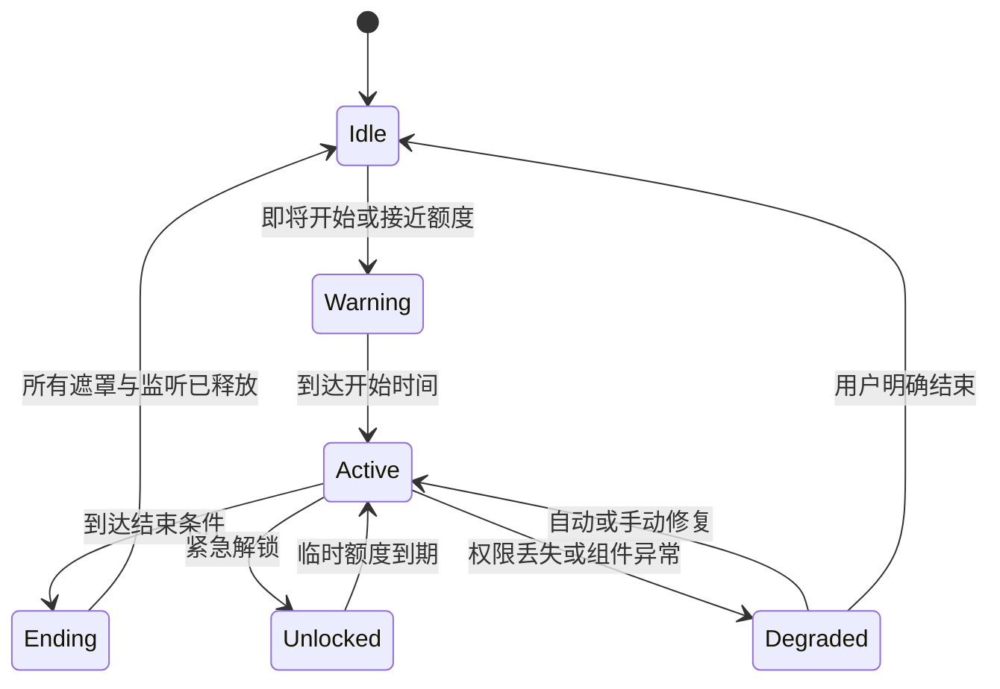

# “守屏”Mac 应用实施计划

> 制定日期：2026-11-20  
> 依据：[产品调研与开发计划](不做电脑控-Mac调研与开发计划.md)  
> 默认路线：Mac 直装版、本人自控、标准模式先落地、强制模式经技术验证后接入

## 1. 实施目标

第一阶段只实现一个完整而可靠的闭环：

> 用户设定一段专注时间或每日额度；到点后，Mac 进入只允许指定应用的专注态；所有屏幕都被覆盖；允许的应用可以从遮罩中启动；到点、达到额度或完成紧急解锁流程后，系统可靠恢复。

首个可安装 Beta 的边界：

- macOS 14 及以上。
- Apple Silicon 和 Intel 通用构建。
- 应用级允许/禁止规则。
- 快速专注、定时专注、睡眠时段、每日额度、连续使用五类规则。
- 多显示器覆盖与全屏应用覆盖。
- 菜单栏常驻和登录后恢复。
- 本地统计与完整数据删除。
- 可选强制模式：键盘、鼠标和触控板事件短时拦截。
- 无账号、无云端、无广告、无网络通信即可完成核心流程。

不建议在 Beta 前加入网站域名拦截、家长远程管理、跨设备同步、订阅系统和 Windows 客户端。

## 2. 工程约束

1. 只使用公开 macOS API，不调用私有接口，不关闭 SIP，不修改系统保护文件。
2. 不采集屏幕画面、窗口标题、网页正文或按键内容。
3. 输入监听只在强制模式且规则生效期间存在，退出后必须销毁。
4. 所有规则状态都要有超时、崩溃恢复和降级路径，不能把电脑锁死。
5. 主应用、后台 helper、更新程序和安装包全部签名。
6. 首发使用 Developer ID 分发并公证，不以“击败管理员或恢复模式”作宣传。

本机当前只有 Command Line Tools，尚未安装完整 Xcode。正式开工前先安装与当前 macOS 26 SDK 兼容的最新稳定 Xcode，并确认能创建、签名和运行 AppKit + SwiftUI 工程。

## 3. 完成定义

一个任务只有同时满足以下条件才算完成：

- 代码合并到主分支。
- 类型检查、构建和单元测试通过。
- 有可复现的验证步骤或场景录像。
- 权限被拒绝、进程崩溃和系统唤醒时有明确行为。
- 不增加未说明的联网、遥测或隐私采集。
- 相关产品文案和隐私说明同步更新。

里程碑不能只以“功能页面已画出”为完成标准，必须通过对应行为验收。

## 4. 建议仓库结构

```text
/
├── ScreenGuard.xcodeproj
├── ScreenGuard.xcworkspace
├── Apps/
│   └── ScreenGuardApp/
├── Packages/
│   └── ScreenGuardKit/
│       ├── Sources/
│       │   ├── Domain/          # 规则、时间、状态机
│       │   ├── Persistence/     # 数据库与迁移
│       │   ├── Activity/        # 前台应用和活跃时间
│       │   ├── Platform/        # AppKit、窗口和输入
│       │   ├── Service/         # XPC 协议与后台守护
│       │   └── SharedUI/        # 共用 SwiftUI 组件
│       └── Tests/
├── Helpers/
│   └── ScreenGuardAgent/
├── Resources/
│   ├── Assets.xcassets
│   ├── Localizations/
│   └── Icon/
├── Scripts/
│   ├── build.sh
│   ├── sign.sh
│   └── notarize.sh
└── docs/
    ├── p0-results.md
    ├── qa-matrix.md
    └── release-notes.md
```

建议从第一天把“纯规则逻辑”和“系统调用”分开。规则状态机可以脱离界面和真实事件做确定性验证，避免多显示器与 TCC 权限问题拖慢核心逻辑。

## 5. 模块职责

| 模块 | 职责 | 关键边界 |
|---|---|---|
| AppCoordinator | 应用生命周期、依赖装配、前后台协调 | 必须运行在 MainActor |
| RuleEngine | 合并时间表、额度、专注会话和休息规则 | 纯 Swift，可确定性测试 |
| PolicyResolver | 判断应用属于允许、禁止、默认允许或系统例外 | bundle identifier 优先 |
| ActivityTracker | 前台应用变化、用户活跃采样、日界切换 | 不读取窗口内容 |
| OverlayCoordinator | 每块屏幕的遮罩窗口和遮罩内容 | 所有窗口操作在 MainActor |
| InputGate | 强制模式的 Core Graphics 事件 tap | 独立线程、快速返回、可立即销毁 |
| ScheduleService | 登录恢复、定时触发、唤醒校正 | 与主界面解耦 |
| ServiceHealthMonitor | 主进程、helper、权限和遮罩健康状态 | 负责安全降级 |
| Persistence | 规则、事件、额度和设置的存储与迁移 | 不存键盘内容 |
| UnlockCoordinator | 紧急解锁、原因选择、冷却和临时额度 | 每次授权带过期时间 |
| Diagnostics | 本地日志、状态导出和权限检查 | 默认不上传 |

## 6. 运行状态机

所有规则先汇聚成一个明确状态，再由状态驱动遮罩和输入层，避免每个功能各自关闭或打开窗口。



### 6.1 状态输入

- 日程开始、结束和跨午夜。
- 快速专注开始、暂停和完成。
- 每日额度达到、跨日重置。
- 连续使用达到玩机阈值或休息阈值。
- 用户打开被禁应用。
- 用户请求紧急解锁。
- 显示器增加、移除或分辨率变化。
- 系统睡眠、唤醒、锁屏和登录。
- 辅助功能、输入监控或后台 helper 不可用。
- 主应用崩溃或收到退出请求。

### 6.2 状态输出

- 遮罩显示或隐藏。
- 被禁应用隐藏、退出或重新切回允许应用。
- 输入事件拦截开启或关闭。
- 菜单栏状态和倒计时。
- 本地使用事件。
- 诊断状态和用户可见提示。

## 7. 数据模型

建议用八个核心实体：

| 实体 | 关键字段 |
|---|---|
| Profile | 名称、当前强度、默认策略、是否启用强制模式 |
| ScheduleRule | 星期、开始、结束、跨日、启用、关联 Profile |
| FocusSession | 开始、计划结束、实际结束、暂停时长、完成状态 |
| UsageBudget | 目标应用集合、每日秒数、重置时区 |
| CycleRule | 使用阈值、休息阈值、重复条件 |
| AppPolicy | bundle identifier、显示名、允许/禁止/默认、应用规则 |
| UsageSample | 时间片、应用标识、是否活跃 |
| UnlockGrant | 原因、开始、到期、授权方式 |

设置项与口令摘要分别存偏好设置和 Keychain。每次强制规则写入带生效时间、结束时间和签名的快照，helper 只读取快照，不直接解释复杂规则。

## 8. 分阶段实施

### 阶段 P0：风险验证，3–5 个工作日

目标是证明技术路径，不追求产品完成度。

| ID | 任务 | 交付物 |
|---|---|---|
| P0-01 | 初始化 Git、Xcode 工程和最小菜单栏应用 | 能运行的原型工程 |
| P0-02 | 每块屏幕建立一个无边框覆盖窗口 | 双屏覆盖演示 |
| P0-03 | 验证 Space、全屏、Mission Control、Stage Manager | 场景矩阵结果 |
| P0-04 | 监听前台应用切换并触发遮罩 | 0.5 秒内遮挡测试 |
| P0-05 | 创建和销毁输入事件 tap | 输入拦截原型 |
| P0-06 | 验证签名应用中的辅助功能与输入监控权限 | TCC 测试记录 |
| P0-07 | SMAppService 登录项和轻量 helper | 退出主程序后的拉起测试 |
| P0-08 | 睡眠、唤醒、显示器热插拔 | 恢复路径记录 |
| P0-09 | 写 docs/p0-results.md | Go / 降级 / No-Go 结论 |

P0 退出标准：

- 普通窗口、全屏应用、至少两块屏幕可以稳定覆盖。
- 前台应用切换能在目标阈值内触发遮罩。
- 输入 tap 可以被安全创建、停用和销毁；权限丢失不会导致锁死。
- 登录项或 helper 能恢复服务，卸载服务后没有残留。
- 所有异常都能通过主应用、helper 或系统重启恢复到可操作状态。

P0 若未通过输入拦截，不停止项目，只把强制模式移出首发；标准遮罩版仍然可以继续。

### 阶段 M1：工程骨架与规则内核，5–7 个工作日

| ID | 任务 | 交付物 |
|---|---|---|
| M1-01 | 建立 Swift Package 模块边界 | 可构建的工作区 |
| M1-02 | 建立 AppCoordinator 与依赖注入 | 可测试的应用生命周期 |
| M1-03 | 实现数据库 schema 和迁移 | v1 数据层 |
| M1-04 | 实现 RuleEngine 状态机 | 纯逻辑规则内核 |
| M1-05 | 实现时间区和跨午夜日程计算 | 日程单元测试 |
| M1-06 | 实现规则优先级与合并 | 冲突用例表 |
| M1-07 | 建立基础日志和诊断状态 | 本地可导出状态 |

退出标准：不启动界面也能通过模拟时钟验证快速专注、定时专注、跨午夜、额度到期和多规则重叠。

### 阶段 M2：前台应用识别与多屏遮罩，7–10 个工作日

| ID | 任务 | 交付物 |
|---|---|---|
| M2-01 | NSWorkspace 激活监听和兜底轮询 | 活动应用流 |
| M2-02 | AppPolicyResolver 与系统例外表 | 应用策略判定 |
| M2-03 | 每屏 OverlayController | 全屏遮罩层 |
| M2-04 | 遮罩内容、倒计时和结束时间 | 标准遮罩界面 |
| M2-05 | 白名单应用启动面板 | 不退出遮罩即可启动允许应用 |
| M2-06 | 被禁应用遮挡、隐藏和返回逻辑 | 应用级拦截闭环 |
| M2-07 | 显示器变化、Space 和全屏场景处理 | 全场景稳定 |
| M2-08 | 菜单栏状态和快速开始/结束 | 日常操作入口 |

退出标准：使用真实应用完成至少 100 次应用切换，遮罩没有残留、没有消失、没有错误覆盖允许应用。

### 阶段 M3：时间规则、统计与自动触发，7–10 个工作日

| ID | 任务 | 交付物 |
|---|---|---|
| M3-01 | 快速专注开始、暂停、完成 | 完整专注流程 |
| M3-02 | 工作日/每日/跨午夜日程 | 自动开始与结束 |
| M3-03 | 前台应用活跃采样 | 使用时长基础数据 |
| M3-04 | 每日额度与跨日重置 | 额度触发 |
| M3-05 | 连续使用与休息周期 | 周期提醒和休息遮罩 |
| M3-06 | 一分钟预警和结束提醒 | 本地通知 |
| M3-07 | 系统时间跳变与睡眠唤醒校正 | 异常恢复机制 |
| M3-08 | 今日统计和按应用查看 | 本地报表 |

退出标准：模拟和真实时间测试均能正确处理跨午夜、休眠三小时、系统时间调整和额度用完后的规则重叠。

### 阶段 M4：后台恢复与强制模式，7–10 个工作日

| ID | 任务 | 交付物 |
|---|---|---|
| M4-01 | 注册登录项和后台 agent | 登录自动恢复 |
| M4-02 | 主进程与 helper 的 XPC 协议 | 健康检查与恢复 |
| M4-03 | 规则快照签名与过期处理 | helper 可控恢复 |
| M4-04 | InputGate 事件拦截和紧急组合键 | 强制模式原型 |
| M4-05 | 权限检测、引导和安全降级 | 权限故障处理 |
| M4-06 | 紧急解锁冷却、原因选择和临时额度 | 解锁闭环 |
| M4-07 | 强制模式退出时自动锁屏或返回桌面 | 安全过渡 |
| M4-08 | 一键停用、卸载和残留清理 | 可撤销后台服务 |

退出标准：主应用被关闭或崩溃后，helper 能在规则有效期内恢复服务；规则过期、用户主动停用或权限失效后，helper 不得继续阻挡。

### 阶段 M5：产品化与首发体验，7–10 个工作日

| ID | 任务 | 交付物 |
|---|---|---|
| M5-01 | 首次引导和预置模板 | 三分钟完成设置 |
| M5-02 | 应用选择器与系统应用例外提示 | 易用且安全的白名单 |
| M5-03 | 权限说明页和状态中心 | 用户看懂为何需要权限 |
| M5-04 | 遮罩文案、插图和完成反馈 | 首发视觉体验 |
| M5-05 | 本地统计空状态、错误状态和修复入口 | 完整状态覆盖 |
| M5-06 | 数据导出、删除和隐私说明 | 数据控制能力 |
| M5-07 | 菜单栏、快捷键和操作习惯统一 | 轻量日常使用 |
| M5-08 | 自动更新、崩溃日志和版本检查 | 可维护安装包 |

退出标准：新用户不阅读外部说明，也能完成“选择允许应用 → 设 25 分钟专注 → 进入遮罩 → 打开允许应用 → 结束恢复”的完整流程。

### 阶段 M6：Beta 与发布，10–15 个工作日

| ID | 任务 | 交付物 |
|---|---|---|
| M6-01 | 多 macOS 版本回归 | QA 矩阵结果 |
| M6-02 | 多显示器、合盖和外接屏回归 | 硬件验证报告 |
| M6-03 | 权限拒绝和系统策略故障演练 | 降级验证 |
| M6-04 | 10–20 名真实用户试用 | Beta 反馈与问题分级 |
| M6-05 | 崩溃、卡死和数据损坏修复 | 发布候选版本 |
| M6-06 | Developer ID 签名、公证和 DMG | 可安装包 |
| M6-07 | 发布说明、隐私政策和卸载说明 | 发布材料 |
| M6-08 | 灰度发布和版本回滚方案 | v1.0 候选 |

Beta 退出门槛：

- 没有可导致电脑持续无法操作的已知严重问题。
- 没有遮罩随机残留或无法移除的问题。
- 规则准确触发的成功率达到内部验收线。
- 用户可以自行卸载、撤回权限和删除数据。

## 9. 单人关键路径

按一名熟悉 macOS 的开发者估算：

| 周次 | 主任务 | 周末必须得到的结果 |
|---|---|---|
| 第 1 周 | P0 技术验证 | 覆盖、事件 tap、登录项三项结论 |
| 第 2 周 | 工程骨架和规则模型 | 无 UI 也能计算正确规则 |
| 第 3 周 | 前台应用与多屏遮罩 | 标准模式闭环 |
| 第 4 周 | 时间、额度和统计 | 自动开始和结束可靠 |
| 第 5 周 | 白名单、休息和异常处理 | 日常使用流程完整 |
| 第 6 周 | helper 和强制模式 | 后台恢复及安全降级 |
| 第 7 周 | 引导、打磨和全量回归 | 发布候选版本 |
| 第 8 周 | 私测、修复、签名和公证 | 第一个可分发 Beta |

这是顺利路径，不计完整视觉设计外包、商标注册和商店审核。更现实的交付区间仍是 **8–12 周**，其中最大的不确定性是 TCC 权限、多显示器覆盖和后台 helper。

## 10. 测试与验收矩阵

### 10.1 系统与硬件

| 维度 | 最少覆盖 |
|---|---|
| macOS | 14、当前稳定版、macOS 26 |
| 芯片 | 至少一台 Apple Silicon；发布通用版时补至少一台 Intel 实机 |
| 显示器 | 单屏、原生双屏、扩展屏热插拔 |
| 显示缩放 | 默认缩放、至少一种非默认缩放 |
| Space | 普通 Space、全屏 Space、跨 Space 切换 |
| 窗口管理 | 普通桌面、全屏应用、Mission Control、Stage Manager |
| 电源 | 合盖、睡眠、唤醒、重启、用户重新登录 |

### 10.2 功能验收

| 场景 | 目标 |
|---|---|
| 被禁应用获得焦点 | 0.5 秒内出现遮罩 |
| 允许应用获得焦点 | 遮罩正确隐藏 |
| 遮罩中启动允许应用 | 1 次点击完成，不先退出规则 |
| 计划开始时间到达 | 5 秒内进入目标状态 |
| 睡眠后跨过开始/结束时间 | 唤醒后 5 秒内校正 |
| 外接屏插入 | 1 秒内出现对应遮罩 |
| 主进程崩溃 | helper 在安全时限内恢复或明确降级 |
| 权限被撤回 | 立即停止高风险操作并提示 |
| 规则结束 | 10 秒内撤除全部遮罩和输入监听 |
| 卸载 | 不残留登录项、helper、扩展和规则状态 |

### 10.3 性能目标

- 空闲 CPU 平均低于 2%。
- 遮罩启用时 CPU 平均低于 5%。
- 常驻内存低于 150 MB，helper 低于 30 MB。
- 输入 tap 回调内不做数据库、网络或界面重布局。
- 连续运行 24 小时无明显资源增长。

## 11. 发布工程

### 11.1 Bundle 与签名

- 主应用 identifier 预留为占位：com.example.shouping。
- helper、登录项和主应用使用不同 bundle identifier，并保持相同的 Team ID。
- 所有嵌套可执行文件先签 helper，再签主应用。
- entitlement 使用最小集合，每个权限写明用途。

### 11.2 Beta 分发

- 使用 Developer ID 签名的 DMG 私测。
- 内置版本号和构建号。
- 提供“导出诊断状态”，默认排除应用使用内容和任何口令。
- 更新系统需要签名并验证更新包。
- 不做静默升级；用户可以看到版本和变更。

### 11.3 发布回滚

- 自动更新分批发布。
- 发现遮罩残留或无法退出时，立即停止新版本推送。
- 提供不依赖网络的手动卸载说明。
- 保留上一稳定版本的下载入口。

## 12. 任务优先级

### P0：没有就无法发布

- 多屏遮罩可靠。
- 应用检测与白名单。
- 定时与额度状态正确。
- 睡眠唤醒恢复。
- 无锁死残留。
- 数据删除和完整卸载。

### P1：首发最好有

- 强制模式。
- 连续使用与休息。
- 本地统计。
- 紧急解锁冷却。
- 菜单栏快捷操作。

### P2：Beta 后

- 浏览器域名规则。
- 提醒语气和主题包。
- 专注成就。
- 小队或同伴监督。
- 跨设备同步。
- 家长受管模式。

## 13. 建议立即创建的首批任务

1. 安装完整 Xcode，初始化 Git 和最小菜单栏应用。
2. 在两块真实屏幕上验证覆盖窗口。
3. 验证全屏应用、Mission Control、Stage Manager 和唤醒恢复。
4. 在签名版本中验证输入 tap、权限请求和安全销毁。
5. 验证 SMAppService helper 的注册、启动、停用和卸载。
6. 根据五项 P0 结果确定首发是否包含强制模式。
7. P0 通过后再搭建正式模块和界面，避免在未验证的路径上投入完整产品开发。

## 14. 决策门

### Gate A：技术路线

P0 完成后，从以下三种结果中选择：

- A1：覆盖、输入和后台都稳定，按完整标准版 + 强制版开发。
- A2：覆盖稳定、输入不稳定，首发做标准版，强制版继续研究。
- A3：覆盖也不稳定，重新评估 MDM、虚拟桌面或受管设备产品形态。

### Gate B：MVP 范围冻结

M2 结束前冻结首发规则和应用策略，不再增加新的核心模块。

### Gate C：Beta 发布

M5 结束后关闭所有 P0 缺陷，才允许进入外部分发。

## 15. 实施完成标准

当以下条件全部满足，第一阶段实施完成：

- 用户可以安装并完成首次设置。
- 到点后所有显示器进入专注遮罩。
- 非白名单应用无法正常露出前台内容。
- 白名单应用可从遮罩中直接使用。
- 到点或额度结束后自动恢复。
- 强制模式存在清晰权限、紧急出口和降级机制，或已明确移出首发。
- 重启、睡眠和崩溃不会造成永久锁死。
- 用户可以删除数据并彻底卸载。
- 有签名、公证、更新和回滚方案。
